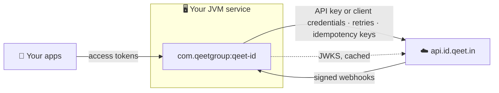

<div align="center">

# ☕ Qeet ID for Java

**The server-side SDK for Qeet ID: manage an organisation's people and access, verify webhooks and access tokens, and run OAuth flows from the JVM.**

[](#-install)
[](#-install)
[](#-modules-and-kotlin)
[](#-modules-and-kotlin)
[](src/test)

[📖 Docs](https://docs.qeet.in) · [🚀 Quick start](#-quick-start) · [🧩 Resources](#-resources) · [📝 Changelog](CHANGELOG.md) · [📐 Engineering practices](docs/engineering-practices.md)

</div>

> [!IMPORTANT]
> Use it on servers only. It authenticates with a secret API key or client secret that must never reach a browser or a mobile app.

## 📦 What's inside

| | |
|:--|:--|
| 🧭 **Typed client** | One thread-safe `QeetID` client with 38 resource groups and **270 API calls**, each checked against the server's OpenAPI documents. Answers are records, requests are builders |
| 🚨 **Typed exceptions** | An unchecked `QeetIDException` hierarchy: one class per HTTP status, `SessionRevokedException`, `OAuthException`, `NetworkException`, `TimeoutException`. Each carries the stable `code`, the status, the request ID and `Retry-After` |
| 🔁 **Safe retries** | Exponential backoff with jitter and `Retry-After`, only for requests that can't act twice. Idempotency keys sent automatically on the nine creates the API makes idempotent |
| 📄 **Pagination** | Iterate or stream a paged list and every item arrives, page by page; whole lists say when they were `truncated` |
| 🪝 **Webhooks** | Timestamped HMAC-SHA256 verification in constant time, two secrets during a rotation, a five-minute replay window, typed events |
| 🔑 **Access tokens** | Local ES256 verification against the issuer's signing keys with the JDK's own cryptography, a required issuer and audience, and a cached, rate-limited key set |
| 🤝 **OAuth** | Client credentials (cached by the client for you), authorization code, refresh, token exchange, device and CIBA grants, introspection, revocation, a token guard |
| 🪶 **Lean** | `java.net.http` for HTTP, `System.Logger` for logs, the JDK for crypto: Jackson is the one runtime dependency, and stays out of the API |

## 🔗 How it fits



| SDK | Language | For |
|:--|:--|:--|
| **Qeet ID for Java** | Java, Kotlin, Scala, Groovy | JVM servers: Spring Boot, Quarkus, Micronaut or plain Java |
| [`@qeet-id/node`](https://github.com/qeetgroup/qeet-id-node) | Node.js / TypeScript | Node.js servers |
| [`qeet-id-go`](https://github.com/qeetgroup/qeet-id-go) | Go | Go servers |

## 📥 Install

Java 17 or later; tested on 17, 21 and 25. Jackson 2.15 or later, which most JVM services already have.

Install from **GitHub Packages**. Reading it needs a GitHub token with `read:packages`: for Gradle, kept in
`~/.gradle/gradle.properties` as `gpr.user` and `gpr.key`; for Maven, in `~/.m2/settings.xml`. Versions are listed on
the [releases page](https://github.com/qeetgroup/qeet-id-java/releases).

**Gradle**

```kotlin
// settings.gradle.kts, inside dependencyResolutionManagement { repositories { … } }
maven {
    url = uri("https://maven.pkg.github.com/qeetgroup/qeet-id-java")
    credentials {
        username = providers.gradleProperty("gpr.user").orNull ?: System.getenv("GITHUB_ACTOR")
        password = providers.gradleProperty("gpr.key").orNull ?: System.getenv("GITHUB_TOKEN")
    }
}

// build.gradle.kts
dependencies {
    implementation("com.qeetgroup:qeet-id:<version>")
}
```

**Maven**

```xml
<!-- pom.xml -->
<repositories>
  <repository>
    <id>github-qeet-id</id>
    <url>https://maven.pkg.github.com/qeetgroup/qeet-id-java</url>
  </repository>
</repositories>

<dependencies>
  <dependency>
    <groupId>com.qeetgroup</groupId>
    <artifactId>qeet-id</artifactId>
    <version><!-- version --></version>
  </dependency>
</dependencies>
```

```xml
<!-- ~/.m2/settings.xml: the server id matches the repository id above -->
<servers>
  <server>
    <id>github-qeet-id</id>
    <username>YOUR_GITHUB_USERNAME</username>
    <password>${env.GITHUB_TOKEN}</password>
  </server>
</servers>
```

## 🚀 Quick start

Create an API key in the Qeet ID console and keep it in a secret store.

```java
import com.qeetgroup.qeetid.QeetID;
import com.qeetgroup.qeetid.access.PermissionCheckParams;
import com.qeetgroup.qeetid.identity.User;
import com.qeetgroup.qeetid.identity.UserCreateParams;

QeetID qeetId = QeetID.builder().apiKey(System.getenv("QEET_ID_API_KEY")).build();
String tenantId = System.getenv("QEET_ID_TENANT_ID");

User user = qeetId.users().create(UserCreateParams.builder()
    .tenantId(tenantId)
    .email("meera@brightleaffoods.in")
    .displayName("Meera Iyer")
    .build());

qeetId.roles().assign(tenantId, user.id(), financeRoleId);

boolean allowed = qeetId.permissions().check(PermissionCheckParams.builder()
    .userId(user.id()).tenantId(tenantId).permission("invoice.approve").build());
```

Build one client per process and share it: it is immutable, safe for concurrent use, and reuses connections.

## ⚙️ Configuration

```java
QeetID qeetId = QeetID.builder()
    .apiKey(System.getenv("QEET_ID_API_KEY"))
    .timeout(Duration.ofSeconds(30))
    .maxRetries(2)
    .appInfo("brightleaf-onboarding", "1.4.0")
    .build();
```

| Builder method | Default | |
|:--|:--|:--|
| `apiKey(key)` | none | Sent as `Authorization: ApiKey <key>`. Every management call needs a credential |
| `clientCredentials(id, secret)` | none | A service principal instead: the client gets a token with the `client_credentials` grant, caches it, and replaces it before it expires |
| `baseUrl(url)` | `https://api.id.qeet.in` | Must be `https`; plain `http` only for `localhost`, `*.localhost` and `127.0.0.1` |
| `timeout(duration)` | 30 s | Each attempt's limit, response body included |
| `maxRetries(n)` | 2 | Retries after a transient failure, for retry-safe requests only; `0` turns them off |
| `retryBackoff(initial, max)` | 0.5 s, 8 s | The exponential backoff's bounds when the server sends no `Retry-After` |
| `header(name, value)` | none | Sent on every request; can't replace `Authorization`, `Accept`, `Content-Type`, `User-Agent` or `Idempotency-Key` |
| `appInfo(name, version)` | none | Put in front of the `User-Agent` |
| `logger(System.Logger)` | `System.getLogger("com.qeetgroup.qeetid")` | See [Logging](#-logging) |
| `httpClient(HttpClient)` | 10 s connect timeout, no redirects | For a proxy, custom TLS or your own executor |

Every call has an overload taking `RequestOptions` last, overriding the client for that call:

```java
qeetId.users().get(userId, RequestOptions.builder()
    .timeout(Duration.ofSeconds(5))
    .maxRetries(0)
    .header("traceparent", traceparent)
    .build());
```

## 🧭 Resources

Identifiers come first, then the parameters, then `RequestOptions`. Answers are records whose components are the API's
fields, camel-cased (`displayName()`, `createdAt()` as an `Instant`); parameters are builders that send only what you set.

| Area | Accessors |
|:--|:--|
| 👥 **Identity** | `tenants()` (the organisation) · `domains()` · `users()` · `groups()` · `invitations()` · `branding()` |
| 🛡️ **Access** | `roles()` · `permissions()` · `relationships()` (ReBAC tuples) · `decisions()` (OpenID AuthZEN) · `authPolicies()` · `securityPolicies()` · `ipRules()` · `threatDetection()` (bots, risk, anomalies) |
| 🌐 **Federation** | `oauth()` · `applications()` (OAuth/OpenID clients and RFC 8707 resources) · `servicePrincipals()` · `samlConnections()` · `samlServiceProviders()` · `ldapConnections()` · `scim()` · `socialProviders()` · `adminPortalLinks()` |
| 🛠️ **Developer** | `apiKeys()` · `agents()` · `verifiableCredentials()` · `authHooks()` · `webhooks()` · `secrets()` · `tokenVault()` |
| 📊 **Operations** | `auditLogs()` · `analytics()` · `billing()` · `gdpr()` · `emailTemplates()` · `retention()` · `logSinks()` · `rateLimits()` |

```java
Page<AuditLogEntry> page = qeetId.auditLogs().list(tenantId, AuditLogListParams.builder()
    .action("user.deleted").from("2026-11-01T00:00:00Z").build());

qeetId.webhooks().update(tenantId, webhookId, WebhookUpdateParams.builder()
    .events(List.of("user.created", "user.deleted")).build());

WebhookSecret rotated = qeetId.webhooks().rotateSecret(tenantId, webhookId);

ListResult<Secret> secrets = qeetId.secrets().list(tenantId);   // secrets.truncated() when capped

// On an update, null is sent as an explicit null, which clears the field.
qeetId.users().update(userId, UserUpdateParams.builder().phone(null).build());
```

The SDK covers the calls an API key may make. A person's own account (their sessions, factors, passkeys, email changes)
is theirs to manage through the hosted pages.

## 🚨 Errors

Every failure is an unchecked exception. Catch the class, or branch on `code()`, never on the message.

| Class | When | Worth reading |
|:--|:--|:--|
| `BadRequestException` | 400 | `code()`, `detail()` |
| `AuthenticationException` | 401 | `code()` |
| ↳ `SessionRevokedException` | 401 `auth.session_revoked` | sign in again; never retried |
| `PaymentRequiredException` | 402 | the plan doesn't include it |
| `PermissionDeniedException` | 403 | `code()` |
| `NotFoundException` | 404 | |
| `ConflictException` | 409 | `code()`, such as `idempotency.outcome_unknown` |
| `ValidationException` | 422 | `fields()`: each field's `code()` and `message()` |
| `RateLimitException` | 429 | `retryAfter()` |
| `InternalServerException` | 5xx | `requestId()` |
| ↳ `ServiceUnavailableException` | 503 | `retryAfter()` |
| `OAuthException` | an OAuth endpoint refused | `error()` is the RFC 6749 code, such as `invalid_grant` |
| `NetworkException` · `TimeoutException` | no response, or none in time | `getCause()` |
| `WebhookVerificationException` | a delivery failed verification | `reason()`, such as `SIGNATURE_MISMATCH` |
| `TokenVerificationException` | an access token failed verification | `reason()`, such as `TOKEN_EXPIRED` |

All of them extend `QeetIDException`; the API ones extend `ApiException`, which also has `status()`, `requestId()`
(quote it to support), `metadata()`, `retryable()` and `headers()`.

```java
try {
  qeetId.users().create(params);
} catch (ValidationException e) {
  e.fields().forEach(f -> log.warn("{} {}: {}", f.field(), f.code(), f.message()));
} catch (ConflictException e) {
  if (!e.code().equals("user.domain_managed_elsewhere")) throw e;   // another organisation manages that domain
} catch (RateLimitException e) {
  log.info("retry in {}, request {}", e.retryAfter(), e.requestId());
}
```

A mistake in your own arguments (a blank id, a malformed idempotency key, a missing required field) is an
`IllegalArgumentException` or `IllegalStateException`, thrown before anything is sent. A call on an interrupted thread
throws `NetworkException` with code `interrupted` and keeps the interrupt flag set.

## 🔁 Retries & timeouts

| | |
|:--|:--|
| ✅ **Retried** | `GET` and `DELETE`; POSTs that change nothing (permission and relationship checks, AuthZEN evaluations, previews, introspection); requests carrying an `Idempotency-Key` |
| ⚡ **After** | no response, a timeout, `408`, `429`, `500`, `502`, `503`, `504`, `409 idempotency.in_progress` |
| ⛔ **Never** | `PUT`, `PATCH` and other POSTs; OAuth grants (single-use); directory sign-in (counts toward the lockout); `401 auth.session_revoked`, whatever the server's `retryable` hint says |
| ⏱️ **Waits** | the server's `Retry-After` up to 60 s (a longer one is thrown as is), otherwise 0.5 s doubling to 8 s with jitter |

Each attempt has its own timeout, response body included.

### 🔂 Idempotency

`users().create`, `groups().create`, `invitations().create`, `servicePrincipals().create`, `apiKeys().create`,
`agents().create`, `webhooks().create`, `billing().checkout` and `billing().payInvoice` always send an
`Idempotency-Key`: one generated per call, so the SDK's own retries never create twice. Give your own to make retries
across calls, deployments or processes safe too:

```java
qeetId.users().create(params, RequestOptions.builder()
    .idempotencyKey("onboarding-" + employee.id())   // 1 to 255 printable ASCII characters
    .build());
```

The API keeps the answer for 24 hours. The same key with another body is refused (`422 idempotency.key_reused`);
`409 idempotency.outcome_unknown` means the first request was interrupted: check whether it took effect before trying
again with a new key. Any other call refuses an idempotency key with an `IllegalArgumentException`.

## 📄 Pagination

Paged lists (users, the audit log, consent grants, SCIM users and groups, anomalies, decisions, webhook deliveries,
relationship objects) return a `Page`. Iterate it, or stream it, and every item arrives, later pages fetched as needed:

```java
for (User user : qeetId.users().list(UserListParams.builder().status("active").limit(100).build())) {
  System.out.println(user.email());
}

List<String> emails = qeetId.users().list().stream().map(User::email).limit(500).toList();

Page<User> page = qeetId.users().list(UserListParams.builder().limit(50).build());
page.data();                                   // this page only
if (page.hasNextPage()) page.nextPage();
for (Page<User> p : page.pages()) { ... }      // page by page
```

Other lists come whole as a `ListResult`: `data()` and `truncated()`, which is `true` when the API capped the list.

## 🪝 Webhooks

Each delivery is a signed POST whose body is an event:

```json
{ "id": "…", "type": "user.created", "tenant_id": "…", "occurred_at": "2026-11-05T09:30:00Z", "data": { … } }
```

`WebhookVerifier` checks `X-Qeet-Signature` (`sha256=` and the HMAC-SHA256 of `X-Qeet-Timestamp`, `.` and the raw body)
in constant time, refuses a delivery signed more than five minutes from now, and returns the typed event. Always pass
the **raw** body: a parsed and re-serialised one won't match.

**Spring Boot**

```java
@RestController
class QeetIdWebhooks {
  private final WebhookVerifier verifier =
      WebhookVerifier.builder().secret(System.getenv("QEET_ID_WEBHOOK_SECRET")).build();

  @PostMapping(path = "/webhooks/qeet-id", consumes = "application/json")
  ResponseEntity<Void> receive(@RequestBody byte[] body, @RequestHeader HttpHeaders headers) {
    WebhookEvent event;
    try {
      event = verifier.verify(body, headers::getFirst);
    } catch (WebhookVerificationException e) {
      return ResponseEntity.badRequest().build();
    }
    if (alreadyHandled(event.id())) {
      return ResponseEntity.noContent().build();        // deliveries can repeat
    }
    switch (event.type()) {
      case WebhookEventTypes.USER_DELETED -> removeLocalData(event.data());
      case WebhookEventTypes.SESSION_REVOKED -> endLocalSession(event.dataAs(SessionRevoked.class));
      default -> { }                                    // newer events: ignore what you don't handle
    }
    return ResponseEntity.noContent().build();
  }

  record SessionRevoked(@JsonProperty("session_id") String sessionId, String reason) {}
}
```

**Servlet or any other server:** `verifier.verify(body, request::getHeader)`, or pass a `Map<String, List<String>>` of
headers; names are matched case-insensitively.

| | |
|:--|:--|
| 🔄 **Rotating the secret** | `webhooks().rotateSecret()` returns a new secret; for 24 hours deliveries carry both signatures. Add both meanwhile: `.secret(newSecret).secret(oldSecret)` |
| 🧾 **Duplicates** | an event's `id()` is the same in every delivery of it, retries included |
| 🆕 **Unknown events** | `type()` may be newer than this SDK; `WebhookEventTypes.ALL` lists those this version knows |
| 🧪 **Testing** | `WebhookVerifier.sign(body, secret, Instant.now())` signs a body the way Qeet ID does |
| ⚠️ **`X-Qeet-Event`** | isn't signed: read `event.type()` instead |

## 🔑 Verifying access tokens

To accept Qeet ID access tokens in your own API, verify them locally against the issuer's signing keys:

```java
TokenVerifier verifier = TokenVerifier.builder()
    .discovery(Discovery.fetch(QeetID.DEFAULT_BASE_URL))     // the issuer and the JWKS URI
    .audience("https://api.brightleaffoods.in")
    .build();

AccessTokenClaims claims = verifier.verify(bearerToken);      // throws TokenVerificationException
claims.subject(); claims.tenantId(); claims.hasScope("invoices:read");
```

Or configure it directly with `.issuer(…)` and `.jwksUri(…)`. Both the issuer and an audience are required. The verifier
accepts ES256 only, needs a known `kid`, checks `iss`, `aud`, `exp`, `nbf` and `iat` with 30 seconds of clock skew
(`clockSkew`), caches the keys for five minutes, refetches them for an unknown `kid` at most every 30 seconds, and keeps
using the keys it has if the issuer is briefly unreachable.

**Spring Security**, as the resource server's `JwtDecoder`:

```java
@Bean
JwtDecoder jwtDecoder(TokenVerifier verifier) {
  return token -> {
    try {
      AccessTokenClaims claims = verifier.verify(token);
      return Jwt.withTokenValue(token)
          .header("alg", "ES256")
          .claims(c -> c.putAll(claims.claims()))
          .issuedAt(claims.issuedAt())
          .expiresAt(claims.expiresAt())
          .build();
    } catch (TokenVerificationException e) {
      throw new BadJwtException(e.getMessage(), e);
    }
  };
}
```

A token verified offline stays valid until it expires, even if its session was revoked. Where revocation must take effect
at once, introspect instead:

```java
TokenGuard guard = qeetId.oauth().tokenGuard("https://mcp.brightleaffoods.in",
    new OAuthClient(System.getenv("MCP_CLIENT_ID"), System.getenv("MCP_CLIENT_SECRET")));
Introspection token = guard.verify(bearerToken, "files:read");   // AuthenticationException or PermissionDeniedException
```

## 🤝 OAuth

```java
// Machine-to-machine: a service principal's token (POST /v1/oauth/token).
ClientCredentialsToken token = qeetId.oauth().clientCredentialsGrant(clientId, clientSecret);
token.accessToken(); token.expiresIn(); token.expiresAt();

// The other grants (POST /v1/oauth/token-code).
qeetId.oauth().authorizationCodeGrant(AuthorizationCodeGrantParams.builder()
    .clientId(clientId).clientSecret(clientSecret)
    .code(code).redirectUri(redirectUri).codeVerifier(codeVerifier).build());
qeetId.oauth().refreshTokenGrant(RefreshTokenGrantParams.builder().clientId(clientId).refreshToken(refreshToken).build());
qeetId.oauth().tokenExchangeGrant(TokenExchangeGrantParams.builder()
    .clientId(clientId).clientSecret(clientSecret).subjectToken(subjectToken).actorToken(agentToken).scope("files:read").build());

qeetId.oauth().introspect(accessToken, new OAuthClient(clientId, clientSecret));
qeetId.oauth().revoke(refreshToken, new OAuthClient(clientId, clientSecret));
```

The device and CIBA flows start with `deviceAuthorization` and `backchannelAuthentication`, then poll with
`deviceCodeGrant` and `cibaGrant`, which throw an `OAuthException` with code `authorization_pending` or `slow_down` until
the person decides. The token endpoints' errors are `OAuthException`s whose `error()` is the RFC 6749 code
(`invalid_client` with status 401, `invalid_grant`, `invalid_scope`, …); the constants on `OAuthException` name them.
Grants are never retried. Client credentials travel in the form body and are never logged.

To call the API as a service principal rather than with an API key, let the client do the grant and cache the token:

```java
QeetID qeetId = QeetID.builder().clientCredentials(clientId, clientSecret).build();
```

## 🗂️ Directory sign-in

`ldapConnections().authenticate` signs a person in with their directory password. The result is tokens, or a
second-factor challenge:

```java
LdapAuthenticationResult result = qeetId.ldapConnections().authenticate(connectionId, username, password);
if (result instanceof LdapAuthenticationResult.Challenge challenge) {
  return askForSecondFactor(challenge.challenge().mfaToken(), challenge.challenge().factors());
}
startSession(((LdapAuthenticationResult.Tokens) result).tokens());
```

## 📝 Logging

The SDK logs through `System.Logger` at `DEBUG`: each attempt's method, path, status, duration and request ID, and each
retry. Never the API key, client secrets, query strings, headers or bodies. With SLF4J, add `slf4j-jdk-platform-logging`
(Log4j: `log4j-jpl`) and set `com.qeetgroup.qeetid` to `DEBUG` to see it. `toString()` on the client, parameters, records
and exceptions never shows a credential or a secret.

## 🧩 Modules and Kotlin

The jar is a named module, `com.qeetgroup.qeetid`, and works on the class path too. Every type is annotated with
[JSpecify](https://jspecify.dev): Kotlin sees `String?` exactly where a value can be absent, and collections are never
null. Records give Kotlin and Scala their component names (`user.displayName()`).

## 🔨 Building

```sh
./gradlew build                 # Error Prone and NullAway, google-java-format, tests on JDK 17, coverage floor
./gradlew test -PtestJdk=25     # the tests on another LTS
./gradlew spotlessApply         # format
```

Gradle downloads the JDKs it needs (17 and 25) if they aren't installed. More in [AGENTS.md](AGENTS.md).

## 📚 Learn more

| | |
|:--|:--|
| 📖 [docs.qeet.in](https://docs.qeet.in) | The Qeet ID documentation |
| 🧩 [apis.qeet.in](https://apis.qeet.in) | The API reference |
| 🧠 [Design decisions](docs/design-decisions) | The Java baseline, Jackson, records and builders, retries, exceptions |
| 📐 [Engineering practices](docs/engineering-practices.md) | The practices this SDK follows, with their sources |
| 📝 [Changelog](CHANGELOG.md) | What's in each version |
| 🔒 [Security](SECURITY.md) | Reporting a vulnerability to security@qeet.in |

---

<div align="center">

Made with 🧡 by Qeet Group · [⬆️ Back to top](#-qeet-id-for-java)

</div>
